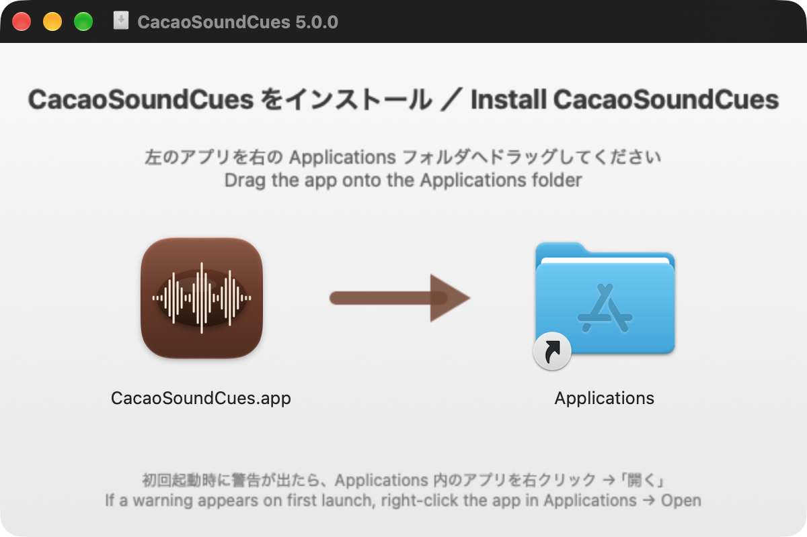
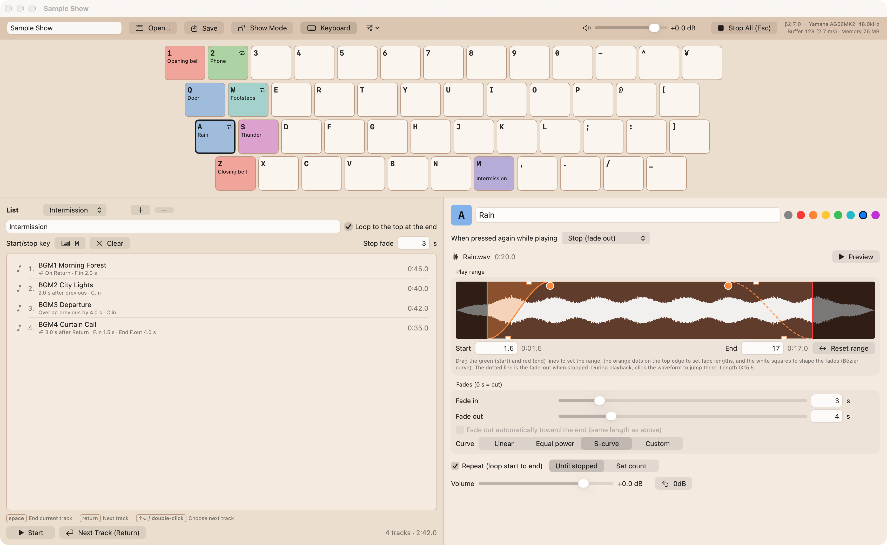
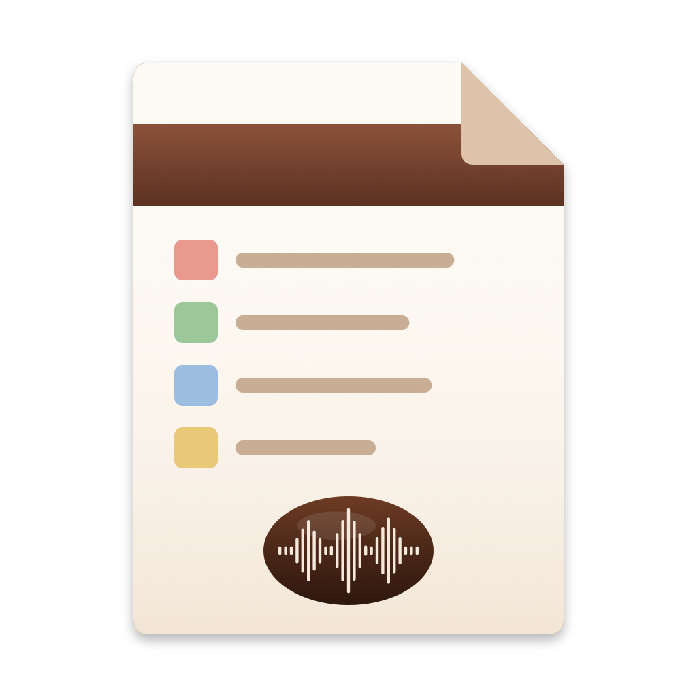
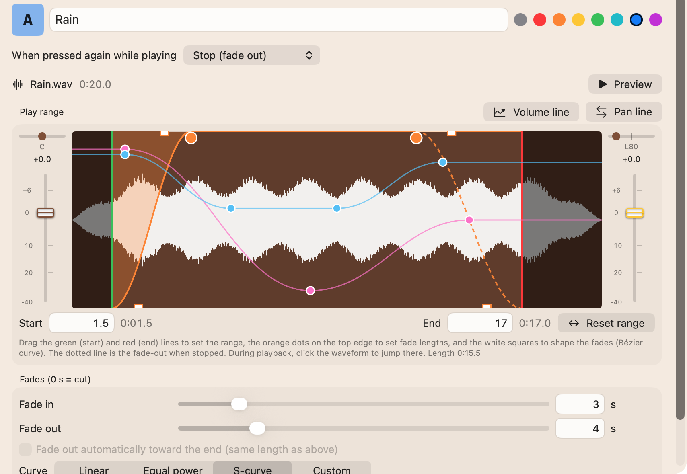
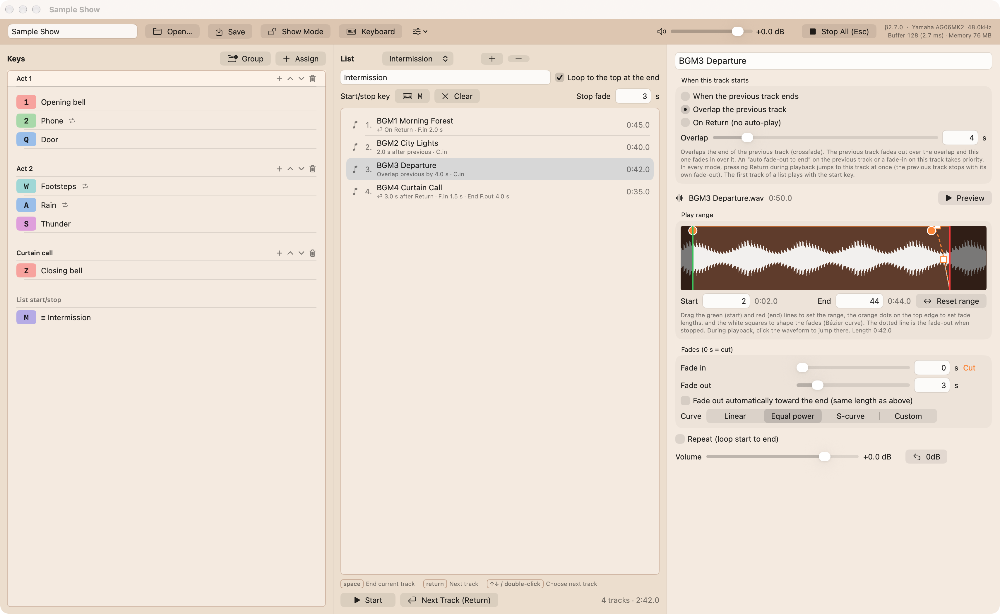
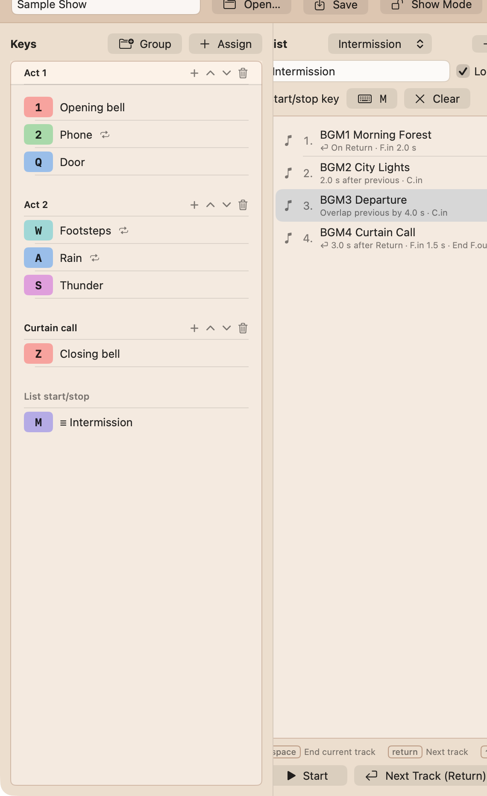
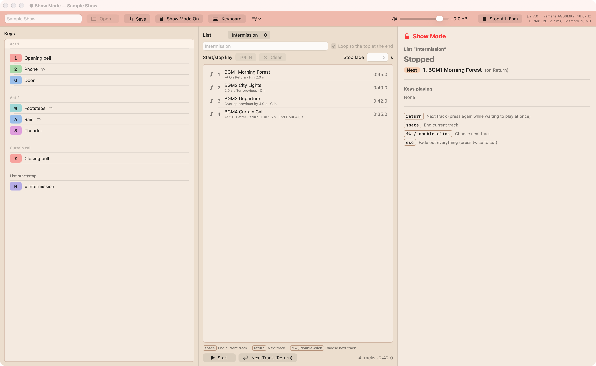
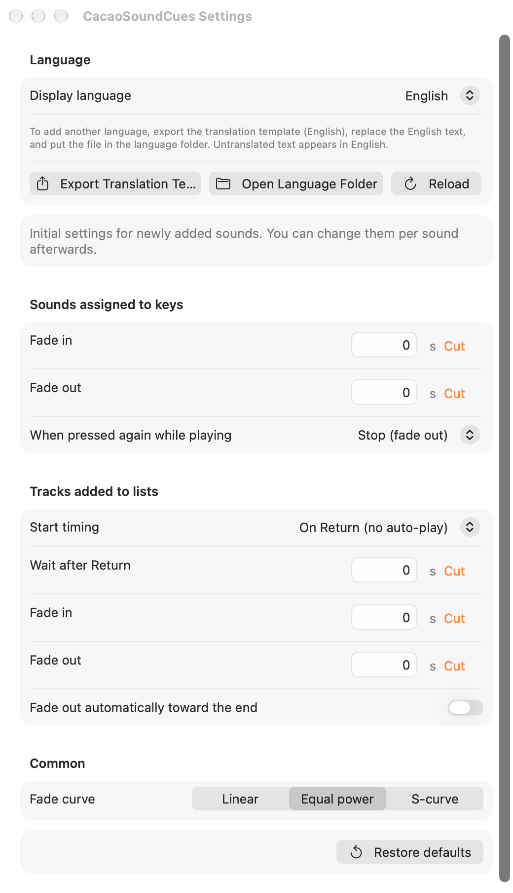

<!-- _class: lead -->
<!-- _paginate: false -->
<!-- _footer: "" -->

# CacaoSoundCues Manual

A sound cue player for the stage
Version 5.0.3 / October 2026

---

## What this manual covers

1. What CacaoSoundCues does
2. Installing and the main screen
3. Assigning sound effects to keys
4. “Lists” that play music in order, e.g. intermission music
5. Running the show (Show Mode and keys)
6. Settings and troubleshooting

> Requires **macOS 14 or later**. No internet connection needed. A MacBook alone is enough to run sound cues for a show.

CacaoSoundCues is **open source** (MIT License) — free to use and to share with your school or theater group.
https://github.com/ICTCacao/CacaoSoundCues

---

## What CacaoSoundCues does

### Play from keys (sound cues)

- Assign audio files to **keys on the keyboard** — press to play instantly
- Set the play range, fade in/out and repeat for each sound
- Press again to fade out and stop

### Play lists in order

- Play intermission music and more **in a set order**
- Choose “after the previous track”, “overlap (crossfade)” or “on Return”
- Plays together with key sound effects

> Sounds are loaded in advance, so there is almost no delay between pressing a key and hearing it.

---

## 1. Installing and launching

1. Double-click **CacaoSoundCues-5.0.3.dmg**
2. Drag **CacaoSoundCues** onto **Applications**
3. Close the dmg (eject the disk icon on the desktop)
4. Double-click CacaoSoundCues in the Applications folder

Supported audio: wav / aiff / mp3 / m4a and anything else your Mac can play. On launch, the cue sheet you used last opens automatically.

**If a warning such as “cannot be verified” appears**
macOS 15 or later: close it, then click **“Open Anyway”** in **System Settings › Privacy & Security**.
macOS 14: **right-click** the app → **Open** → **Open**. After the first time, it opens normally.

---

## 2. The main screen

Top: buttons, master volume / Middle: keyboard / Bottom left: list / Bottom right: selected sound

---

## 3. Cue sheets (the files you save)

- Everything for one show is saved as a **cue sheet (.ccsc)**
- **The audio files are copied into the cue sheet**
- Carry the cue sheet on a USB stick and it works **as is on another Mac**

| Action | Menu |
|---|---|
| New | File › New Cue Sheet <kbd>⌘</kbd><kbd>N</kbd> |
| Open | File › Open… <kbd>⌘</kbd><kbd>O</kbd> |
| Save | File › Save <kbd>⌘</kbd><kbd>S</kbd> |

---

## 4. Assigning sounds to keys

1. **Drag** an audio file from the Finder **onto a key** on screen
2. The key gets a color and a name — done
3. Press the key to play. **Press again to stop**

**Changing assignments**
- **Drag** an assigned key **onto another key** to move it
- If the other key is assigned too, they **swap**
- To remove: right-click the key → “Remove assignment”

**Keys you can use**
Number, letter and symbol keys. **F1–F12** and the **numeric keypad** can be turned on too (the <kbd>☰</kbd> button in the top bar). The same button changes the keyboard size (large, medium, small).

**Reserved keys (controls)**

| Key | Role |
|---|---|
| <kbd>return</kbd> | Next track in the list |
| <kbd>space</kbd> | End the current list track |
| <kbd>esc</kbd> | Stop everything |

---

## 5. Sound settings (click a key to show them on the right)

| Item | What it does |
|---|---|
| Name and color | Shown on the key |
| When pressed again | Stop / restart / layer / nothing |
| Play range | The part to play (start and end) |
| Fade in / out | In seconds. **0 s = cut** |
| Curve | Linear / Equal power / S-curve / Custom |
| Repeat | Until stopped, or a set count |
| Volume / Pan | Faders left of the waveform |
| Volume line | Volume changes; record with the right fader |
| Pan line | Pan changes; record with the right pan slider |

Use “Preview” to listen.

---

## 6. Range and fades on the waveform

| Drag | To change |
|---|---|
| **Green line** | Where playback starts |
| **Red line** | Where playback ends |
| **Orange dots** on the top edge | Fade lengths |
| **White squares** | Fade shape (Bézier curve) |

- Moving a white square switches the curve to “Custom”
- The **dotted line** is the fade-out used when you stop the sound
- During playback, click the waveform to jump there

**While playing**
During a fade, a yellow line and dot move along the fade shape.

- Fade in: the dot rises ↑
- Fade out: the dot falls ↓

> You can also type fade times in the fields below. Press <kbd>return</kbd> to confirm.

**Volume line**
Turn on “Volume line” to draw the volume through the track. Click to add a point, drag to move, <kbd>⌥</kbd>-click to delete.

---

## 7. Making a list (e.g. intermission music)

Click ＋ next to “List”, then drag track files into the list. You can also set a start/stop key (e.g. <kbd>M</kbd>).

---

## 7. Lists and keys: which to use

### The usual way
- **Sound effects** (bells, phones, doors) go on **keys** → press the key on the cue
- **Music** can go in a **list** or on a **key**
  - Several tracks in a row (pre-show, intermission, post-show): a **list** → <kbd>return</kbd> moves to the next track
  - One track brought in and out for a scene: a **key** → press it again to fade out

### Running a whole show from one list
If every sound — effects and music alike — finishes before the next one starts (nothing overlaps), you can **put all of them in one list, in show order**.
Set each track to start “**On Return**”, and during the show you just press <kbd>return</kbd> again and again, all the way to the end.

- The next sound is marked “**Standby**”, so you can check each cue before you go
- If an effect has to play over music, put that effect on a key instead

---

## 8. When each track starts

Click a track to choose on the right.

| Timing | Behavior |
|---|---|
| **On Return** | No auto-play. Plays when you press <kbd>return</kbd>. Can also wait n seconds after Return |
| **When the previous track ends** | Plays automatically after the previous track. You can set a gap |
| **Overlap the previous track** | Starts over the end of the previous track (**crossfade**). The previous one fades out automatically |

- Check “Loop to the top at the end” to play the list over and over
- **Only one list plays at a time**. Starting another list stops the current one

---

## 9. List controls

| Key | Action |
|---|---|
| <kbd>return</kbd> | **Play Standby** (next track). The current track stops with its own fade-out. Starts the list if it is stopped |
| <kbd>return</kbd> twice | Skip the “wait n seconds” and play at once |
| <kbd>space</kbd> | **End the current track early**. The next one follows its own timing |
| <kbd>↑</kbd> <kbd>↓</kbd> / double-click | **Set as Standby** (does not play). It is marked **Standby** |
| Start/stop key | Start / stop that list |
| <kbd>esc</kbd> | **Stop all sounds at once** (no fade) |

> Example: when the curtain falls, press <kbd>space</kbd> to end the music → after the blackout, press <kbd>return</kbd> for the next track.

---

## 10. Hiding the keyboard (key list)

Click **“Keyboard”** in the top bar to hide the keyboard and show **only the assigned keys** as a list.

- Organize keys into **groups** (e.g. Act 1, Act 2)
- Drag rows to reorder
- Right-click → “Move to group”
- Drag an audio file onto the list → press the key to assign

For list-centered shows, this view is easier to read. The panel on the right can also be hidden with **“Inspector”** in the top bar.

---

## 11. Show Mode

“Show Mode” (<kbd>⇧</kbd><kbd>⌘</kbd><kbd>L</kbd>) turns the top bar red and shows the current track, time left and next track in large type.

---

## 11. What works in Show Mode

### Works

- Playing and stopping keys
- <kbd>return</kbd> <kbd>space</kbd> <kbd>↑</kbd><kbd>↓</kbd> <kbd>esc</kbd>
- Double-click to choose the next track
- Master volume
- Save

### Locked (to prevent accidents)

- Changing sound settings or assignments
- Editing lists and groups
- Preview (the audience would hear it)
- Jumping by clicking the waveform
- New / Open

> Leaving Show Mode and quitting the app both ask for confirmation. Show Mode stays on after a restart.

---

## 12. Settings (CacaoSoundCues › Settings… <kbd>⌘</kbd><kbd>,</kbd>)

**Language**
Switch between 日本語 and English. The menu bar changes after a restart.
For other languages, export the translation template (English), translate it, and put it in the language folder.

**Initial settings for new sounds**
The starting fades and timing used when you add sounds to keys or lists.

---

## 13. Checklist before the show

- ☐ The cue sheet is **saved** (the title does not say “Unsaved”)
- ☐ Every sound was played on **the Mac and speakers used in the show**
- ☐ Master volume and the Mac’s volume are set
- ☐ **The first track of the list is double-clicked and shows Standby**
- ☐ Notifications are off (Focus mode). The app prevents sleep itself
- ☐ **Show Mode** is on
- ☐ You know where <kbd>esc</kbd> (stop everything) is

> Keep a **backup** of the cue sheet on a USB stick too.

---

## 14. Troubleshooting

| Problem | What to do |
|---|---|
| A key does not play | A text field still has the cursor. **Click the list or a key**, or press <kbd>return</kbd> |
| F keys do not play | Hold <kbd>fn</kbd>, or turn on “Use F1, F2, etc. keys as standard function keys” in macOS |
| A key shows ⚠ | The audio file is missing or unreadable. Assign it again |
| Too quiet / no sound | Check master volume, the sound’s volume, and the output device (top right) |
| Cannot edit in Show Mode | Click “Show Mode On” in the top bar to leave it |
| Played the wrong sound | Press that key again. For everything, <kbd>esc</kbd> |

---

## Key reference

| Key | Action |
|---|---|
| Assigned key | Play / press again to stop |
| <kbd>return</kbd> | Next track in the list (twice: skip the wait) |
| <kbd>space</kbd> | End the current list track |
| <kbd>↑</kbd> <kbd>↓</kbd> | Choose the Standby track in the list |
| <kbd>esc</kbd> | Stop all sounds at once |
| <kbd>⇧</kbd><kbd>⌘</kbd><kbd>L</kbd> | Show Mode on / off |
| <kbd>⌘</kbd><kbd>S</kbd> / <kbd>⌘</kbd><kbd>O</kbd> / <kbd>⌘</kbd><kbd>N</kbd> | Save / Open / New |
| <kbd>⌘</kbd><kbd>,</kbd> | Settings |

<!-- _footer: "CacaoSoundCues Manual / ICTCacao / For community theater and school drama" -->
