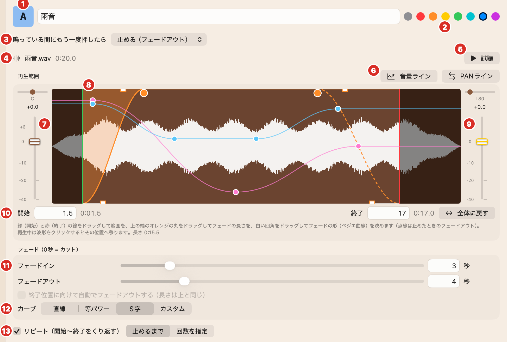
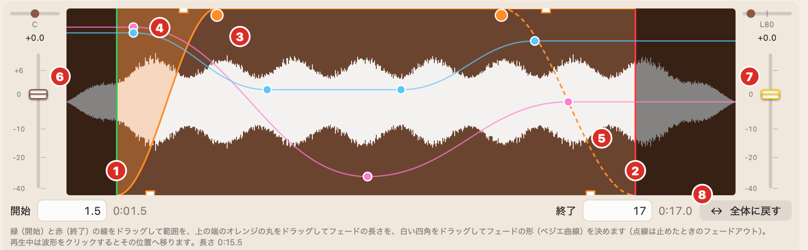
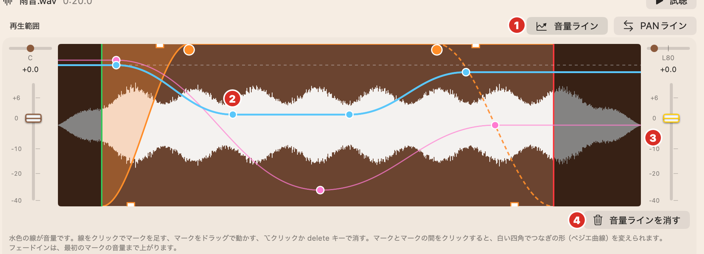
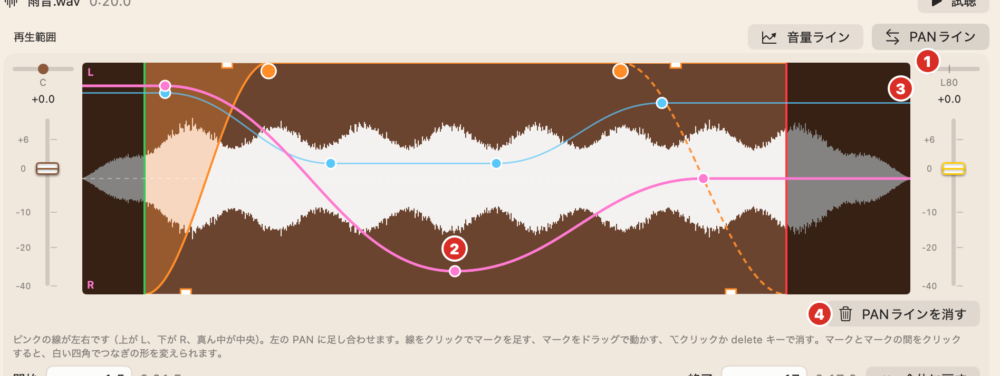
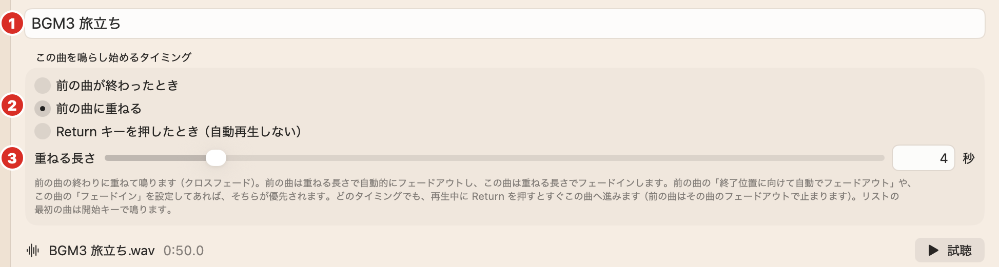

<!-- _class: lead -->
<!-- _paginate: false -->
<!-- _footer: "" -->

# CacaoSoundCues マニュアル

舞台のための、ポン出し音響アプリ（Windows 版）
バージョン 5.1.1 ／ 2026 年 10 月

---

## このマニュアルの読み方

**はじめて使う人は、まず「はじめの 5 ステップ」をやってみてください。** 音が出るところまで、10 分くらいでできます。

| 知りたいこと | 見るところ |
|---|---|
| とにかく音を出したい | はじめの 5 ステップ |
| 音の長さ・フェード・音量をくわしく決めたい | **音源設定**（いちばんくわしく書いています） |
| BGM を順番に流したい | リスト |
| 本番でまちがえないようにしたい | 本番モード・本番前のチェックリスト |

> 対応: **Windows 10 ／ 11（64 ビット）**。インターネットは要りません。ノートパソコン 1 台で本番の音出しができます。
> 画面の写真は Mac 版ですが、使い方は同じです（写真の「return」は <kbd>Enter</kbd>）。

CacaoSoundCues は**オープンソース**（MIT License）です。無料で使え、学校や劇団で自由に配れます。 https://github.com/ICTCacao/CacaoSoundCues

---

## 先におぼえておきたい言葉

| 言葉 | 意味 |
|---|---|
| **ポン出し** | きっかけに合わせて、ボタン（キー）1 つで音を出すこと |
| **きっかけ** | 「ここで音を出す」と決めたタイミング（セリフ・照明・役者の動きなど） |
| **効果音** | ベル・電話・ドア・雷など、場面を表す短い音 |
| **BGM** | 場面の後ろで流す音楽。客入れ・幕間・客出しにも使う |
| **フェードイン／フェードアウト** | 音がだんだん大きくなる／だんだん小さくなること |
| **カット** | フェードしないで、いきなり鳴らす／止めること |
| **PAN（パン）** | 音が左右どちらのスピーカーから聞こえるか |
| **Standby（スタンバイ）** | 「次に鳴る準備ができた」という意味。舞台で使う言い方 |
| **キューシート** | 1 つの公演の音の設定を、全部まとめて保存したファイル |

---

## CacaoSoundCues でできること

### キーで鳴らす（ポン出し）

- 音のファイルを**キーボードのキー**に割り当てて、押せばすぐ鳴る
- 鳴らす部分・フェード・くり返し・音量・左右を、音ごとに決められる
- 鳴っているキーをもう一度押すと止まる

### リストで順番に流す

- 幕間 BGM などを**決めた順番**で流す
- 「前の曲が終わったら」「重ねて」「Enter を押したら」から選べる
- キーの効果音と同時に鳴らせる

> 音はあらかじめ読み込んでおくので、キーを押してから鳴るまでの遅れがほとんどありません。

---

## 1. インストールと起動

1. **CacaoSoundCues-5.1.1-Windows-x64.zip** を右クリック →「**すべて展開**」
2. 出てきた **CacaoSoundCues-5.1.1-Windows-x64-setup.exe** をダブルクリック
3. 画面の案内どおりに「次へ」→「インストール」
4. スタートメニューの **CacaoSoundCues** から起動

管理者の権限は要りません（使っている人のアカウントにインストールされます）。起動すると、前に開いていたキューシートが自動で開きます。

> **「Windows によって PC が保護されました」と出たら**
> 青い画面の「**詳細情報**」を押すと、「**実行**」ボタンが出ます。それを押すとインストールが始まります。
> （個人で作ったアプリなので、最初だけこの表示が出ます）

新しい版を入れるときも、同じように setup.exe を実行すれば上書きされます。キューシートは消えません。

---

## 2. 画面の見かた

**上**：ボタンと全体の音量・全停止 ／ **真ん中**：キーボード（音を割り当てたキーに色と名前が付く） ／ **左下**：リスト（あるとき） ／ **右下**：音源設定（選んだ音の設定。何も選んでいないときは「使い方」）

---

## 3. はじめの 5 ステップ（1）

STEP 1 **音を用意する**
BGM（音楽）や効果音のファイルを、パソコンの中に用意します。
使えるファイル：wav ／ mp3 ／ m4a ／ aac ／ flac ／ ogg ／ aiff など

STEP 2 **上のキーボードにドラッグする**
音のファイルを、画面の上にあるキーボードの、好きなキーの上へドラッグします（マウスでつかんで、運んで、はなす）。

> ⚠ 右下の「使い方」の上にドラッグしても入りません。**必ずキーの上**へ。

パソコンのキーボードでそのキー（例 <kbd>A</kbd>）を押して、**音が出たら OK！**
画面のキーをクリックすると、右側の**音源設定**で、その音の設定ができます。
いろいろな音を、ほかのキーにもドラッグしてみましょう。

---

## 3. はじめの 5 ステップ（2）

STEP 3 **順番に流す BGM のリストを作る**
右側の「使い方」の ♫ リストを作る をクリックします。幕間の BGM など、曲を順番に流せます（リストの欄が出ます）。

STEP 4 **リストに曲をドラッグする**
音のファイルを、出てきたリストに何曲かドラッグします。上から順番に流れます。
リストの曲をクリックすると、右側の音源設定で、その曲の設定ができます。

STEP 5 **リストを鳴らしてみる**
リストの曲をダブルクリックすると Standby になります（次に鳴る準備ができた、という意味）。
<kbd>Enter</kbd> キーを押して、**曲が流れたら OK！**

> 止めたいときは <kbd>Esc</kbd> か、右上の ■ 全停止（Esc）。すべての音がすぐ止まります。

---

## 4. キューシート（保存するファイル）

- 公演 1 本ぶんの設定を **キューシート（.ccsc）** として保存します
- **使う音のファイルも、キューシートの中にコピー**されます。元のファイルを消したり動かしたりしても大丈夫
- キューシートを USB などで運べば、**別のパソコンでも、Mac 版でも**そのまま使えます

| 操作 | やりかた |
|---|---|
| 新しく作る | 左上の <kbd>☰</kbd> › 新規キューシート <kbd>Ctrl</kbd><kbd>N</kbd> |
| 開く | 開く… で .ccsc のフォルダを選ぶ <kbd>Ctrl</kbd><kbd>O</kbd>。フォルダを画面へドラッグしても開ける |
| 保存 | 保存 <kbd>Ctrl</kbd><kbd>S</kbd> ／ 別名で保存 <kbd>Ctrl</kbd><kbd>Shift</kbd><kbd>S</kbd> |

キューシートは「〇〇.ccsc」という名前の**フォルダ**です。中には音のファイルと設定が入っています。中のファイルは、さわらないでください。

---

## 5. キーに音を割り当てる

1. エクスプローラーから音のファイルを、画面の**キーの上へドラッグ**
2. キーに色と名前が付けば完了
3. そのキーを押すと鳴ります。**もう一度押すと止まる**

**割り当てを変える**
- キーを**別のキーへドラッグ**で移動（先にも音があれば入れかわる）
- <kbd>Ctrl</kbd>＋ドラッグで**空いているキーへコピー**（音量などを変えて使う）
- 右クリック →「割り当てを外す」で外す。「音ファイルを割り当てる…」でも割り当てられる

**使えるキー**
数字・英字・記号のキー。**F1〜F12** と**テンキー**も使えます（**設定**（上の帯の歯車）›「キーボード」で表示）。キーボードの配列（日本語 JIS ／ 英語 US）と大きさ（大・中・小）も、そこで変えられます。

**使えないキー（操作に使うため）**

| キー | 役目 |
|---|---|
| <kbd>Enter</kbd> | リストの次の曲へ |
| <kbd>Space</kbd> | リストの今の曲を終える |
| <kbd>Esc</kbd> | 全部止める |

---

<!-- _class: lead -->

# 音源設定

キーやリストの曲をクリックすると、右側に出る設定です。
鳴らす部分・フェード・くり返し・音量・左右を、音ごとに決めます。

---

## 6. 音源設定の全体（キーの音）

<table class="tight">
<tr><td>1</td><td>キーと名前</td></tr>
<tr><td>2</td><td>キーの色</td></tr>
<tr><td>3</td><td>鳴っている間にもう一度押したら</td></tr>
<tr><td>4</td><td>音のファイル名と長さ</td></tr>
<tr><td>5</td><td>試聴</td></tr>
<tr><td>6</td><td>音量ライン・PANライン</td></tr>
<tr><td>7</td><td>左のつまみ（基本の左右と音量）</td></tr>
<tr><td>8</td><td>波形（鳴らす部分とフェード）</td></tr>
<tr><td>9</td><td>右のつまみ（いまの左右と音量）</td></tr>
<tr><td>10</td><td>開始・終了（秒）</td></tr>
<tr><td>11</td><td>フェードイン・フェードアウト</td></tr>
<tr><td>12</td><td>フェードのカーブ</td></tr>
<tr><td>13</td><td>リピート（くり返し）</td></tr>
</table>

次のページから、番号の順に説明します。

---

## 1 名前 ／ 2 色

### 1 名前

- 最初は**ファイルの名前**が入っています
- 台本のきっかけに合わせた名前にすると、本番で迷いません
  例：「開演ベル」「1幕 電話」「雷（大）」
- 入れたら <kbd>Enter</kbd> で決まります

### 2 色

- 8 色から選べます。キーボードのキーがその色になります
- **色で役わりを分ける**と、本番で見つけやすくなります

| 例 | 色 |
|---|---|
| ベル・合図 | 赤 |
| 自然の音（雨・風・雷） | 青 |
| BGM | 緑 |

> 名前を入れている間は、キーを押しても音は鳴りません（文字が入るため）。入れ終わったら <kbd>Enter</kbd> を押しましょう。

---

## 3 鳴っている間にもう一度押したら

その音が鳴っているときに、**同じキーをもう一度押したらどうするか**を決めます。

| えらぶもの | どうなる | こんな音に |
|---|---|---|
| **止める（フェードアウト）** | 11 のフェードアウトの秒数で、だんだん小さくなって止まる。**0 秒ならすぐ止まる** | ほとんどの音（最初はこれ） |
| **頭から鳴らし直す** | 今の音を止めて、最初からもう一度鳴らす | 電話のベルを鳴らし直す、ブザー |
| **重ねて鳴らす** | 今の音はそのままで、もう 1 つ重ねて鳴らす | 銃声・足音・拍手など、続けて何回も鳴らす音 |
| **何もしない** | 押しても何も起きない | 長い BGM を**うっかり止めたくない**とき |

> 「何もしない」にした音を止めるときは、<kbd>Esc</kbd>（全停止）を使います。

---

## 4 ファイル名 ／ 5 試聴

### 4 音のファイル名と長さ

- 割り当てた音のファイルの名前と、全体の長さ（分:秒）
- ファイルが見つからない・読めないときは、ここに**赤い字**で理由が出ます

### 5 試聴 ▶ 試聴

- 今の設定（鳴らす部分・フェード・音量など）で鳴らして、**聞いて確かめる**ボタン
- もう一度押すと止まります
- 設定を変えたら、試聴で確かめるクセをつけましょう

> 本番モードでは試聴できません（客席に聞こえてしまうため）。

---

## 8 波形で「鳴らす部分」と「フェード」を決める

1 **緑の線**…鳴らし始める位置。ドラッグで動かす
2 **赤の線**…鳴らし終わる位置
3 **オレンジの丸**…フェードの長さ。左右にドラッグ
4 **白い四角**…フェードの形。ドラッグで曲げる

5 **点線**…止めたときのフェードアウトの形
6 7 **左右のつまみ**…音量と左右（あとで説明）
8 **全体に戻す**…鳴らす部分を、曲の最初〜最後に戻す
**暗い部分**は鳴らない部分です

---

## 8 10 鳴らす部分の決め方（例つき）

### 線をドラッグする
- 波形の山（白い部分）を見て、**音が始まるところに緑の線**、**終わらせたいところに赤の線**を置く
- 最初に無音がある音は、緑の線を音の始まりまで動かすと、**押した瞬間に鳴る**ようになります

### 秒で入れる 10
- 「開始」「終了」の欄に秒を入れて <kbd>Enter</kbd>
- 右に「分:秒」で表示されます

> **例 1：曲のサビから鳴らしたい**
> 試聴しながらサビの始まりを探し、そこへ緑の線を動かす。フェードインを 1〜2 秒にすると自然に入ります。

> **例 2：長い雷の音を短く使いたい**
> 赤の線を「ゴロゴロ」が終わるところへ。フェードアウトを 1 秒くらいにすると、ぶつっと切れません。

鳴らしている間に波形をクリックすると、その位置へ飛びます（本番モードではできません）。

---

## 11 フェードイン・フェードアウト

**フェードイン**：鳴らし始めに、音が**0 から**だんだん大きくなる長さ
**フェードアウト**：音が**だんだん小さくなって**消える長さ

- 秒で決めます（スライダーは 0〜20 秒。欄には直接入れられます）
- <strong>0 秒 =「カット」</strong>（いきなり鳴る／いきなり止まる）。0 のときは、横に オレンジの「カット」の文字が出ます
- 波形の上の端の**オレンジの丸**をドラッグしても変えられます

| 音 | フェードイン | フェードアウト |
|---|---|---|
| 開演ベル・電話・ドア | 0（カット） | 0〜0.5 |
| 雨・風などの環境音 | 2〜5 秒 | 3〜5 秒 |
| 場面の BGM | 0〜3 秒 | 3〜8 秒 |
| 暗転での BGM 終わり | — | 2〜4 秒 |

数字は目安です。舞台で実際に聞いて決めましょう。

---

## 11 フェードアウトは 2 つの場面で使われる

### ① とちゅうで止めたとき（点線）
鳴っている途中で、
- 同じキーをもう一度押した
- リストで <kbd>Space</kbd> や <kbd>Enter</kbd> を押した

…ときに、**フェードアウトの秒数で小さくなって止まります**。波形の**点線**がその形です。

### ② 最後まで鳴ったとき
<strong>「終了位置に向けて自動でフェードアウトする」</strong>にチェックすると、**赤の線（終わり）に向かって**、同じ秒数で自動で小さくなります。

- 曲を途中で終わらせたいとき、終わりがぶつっと切れません
- リピートが「止めるまで」のときは使えません（終わりがないため）

> チェックしないときは、最後まで鳴ったら**そのまま**終わります（曲の終わりがもともと消えていく曲なら、これで OK）。

---

## 12 フェードのカーブ

フェードで、音の大きさが**どんな形で**変わるかです。ちがいは小さいので、**最初は「等パワー」のままで大丈夫**です。

| カーブ | 変わり方 | 向いている場面 |
|---|---|---|
| **直線** | 同じ速さで変わる | 短いフェード、機械的に消したいとき |
| **等パワー** | 耳で聞いて**自然に**小さく・大きくなる | ほとんどの場面。曲どうしを重ねるとき |
| **S字** | ゆっくり始まり、まん中で速く、ゆっくり終わる | 長いフェード、ふんわり入れたい・消したいとき |
| **カスタム** | 波形の**白い四角**で、自分で形を作る | 好きな形にしたいとき |

白い四角をドラッグすると、カーブは自動で「カスタム」になります。

---

## 13 リピート（くり返し）

<strong>「リピート（開始〜終了をくり返す）」</strong>にチェックすると、緑の線から赤の線までを**くり返して**鳴らします。

| えらぶもの | どうなる | 例 |
|---|---|---|
| **止めるまで** | キーを押して止めるまで、ずっとくり返す | 雨・風・虫の声などの環境音、電話の呼び出し音 |
| **回数を指定** | 決めた回数だけ鳴らして終わる（2〜99 回） | ノック 3 回、足音を 4 歩ぶん |

> **きれいにくり返すコツ**
> くり返しのつなぎ目で「ぷつっ」と聞こえるときは、緑と赤の線の位置を少し動かして、つなぎ目が自然に聞こえるところを探します。

リピートしている音は、キーボードとキーの一覧に <kbd>⇄</kbd> の印が付きます。

---

## 7 左のつまみ：基本の音量と左右

### 音量（たてのつまみ）
- この音の**基本の大きさ**。上げると大きく、下げると小さく（+10 〜 −40 dB）
- **0 = ファイルそのままの大きさ**
- 鳴っている間に動かすと、**すぐ**音が変わります
- **ダブルクリックで 0 に戻る**

### 左右（上の横のつまみ）
- 左へ動かすと左のスピーカー、右へ動かすと右のスピーカーから聞こえます
- 「C」= まん中。「L80」= 左に 80%
- **ダブルクリックでまん中に戻る**

> **音量の合わせ方のコツ**
> 1. いちばん大きく聞かせたい音を、0 のままにする
> 2. ほかの音を試聴しながら、それより小さくなるように下げる
> 3. 最後に、本番の会場で**全体の音量**（上の帯）を決める

dB（デシベル）は音の大きさの単位です。−6 dB でだいたい半分くらいの大きさに聞こえます。

---

## 6 音量ライン：曲の中で音量を変える

1 **音量ライン**を押すと、波形の上に**水色の線**が出て、編集できます
2 線を**クリックでマーク（点）を足す**、マークを**ドラッグで動かす**、<kbd>Alt</kbd>＋クリックか <kbd>Delete</kbd> で消す
3 右のつまみ（黄色）は、いまの音量。4 **音量ラインを消す**で、線を全部消して元に戻します

---

## 6 音量ラインの使いかた（例つき）

### 線のルール
- 線が**上**ほど大きく、**下**ほど小さい（まん中の点線が 0 dB）
- マークとマークの間は、なめらかにつながります
- マークの間をクリックすると、**白い四角**でつなぎの形を変えられます
- フェードインは、**最初のマークの大きさ**まで上がります
- 選んだマークの「時間 ／ 音量」が下に出ます

> **例：セリフの間だけ BGM を小さくしたい**
> 1. 音量ラインを押す
> 2. セリフが始まるところと終わるところに、それぞれ 2 つずつマークを足す
> 3. まん中の 2 つを、下（−12 dB くらい）へドラッグ
> 4. 試聴して確かめる
>
> → セリフの間だけ、BGM が自動で小さくなります。

---

## 9 右のつまみ：聞きながら線を書く

右のつまみ（黄色）は、<strong>「いまの音量・いまの左右」</strong>を表します。音量ラインや PANライン があると、鳴っている間、線に合わせて**自動で動きます**。

### 鳴っている間にドラッグすると
**動かしたとおりに、線が書かれます**（録音のように記録）。
1. 試聴を押す
2. 聞きながら、右のつまみを上げ下げする
3. 指をはなすと、記録が終わる

押さえている間は、動かさなくても今の値を書き続けます。

### 止まっているときにドラッグすると
**線全体が、同じだけ上下**します（形はそのまま）。線がないときは、左のつまみ（基本の音量・左右）が動きます。

> 手で線を描くのが難しいときは、**聞きながらつまみを動かす**ほうが簡単です。

---

## 6 PANライン：曲の中で左右を動かす

1 **PANライン**を押すと、**ピンクの線**が出ます。2 線の**上が L（左）、下が R（右）、まん中が中央**
3 右上の横のつまみを、鳴っている間に動かすと線が書けます。4 **PANラインを消す**で元に戻ります

---

## 6 PANラインの使いかた（例つき）

### 線のルール
- 操作は音量ラインと同じ（クリックでマーク、ドラッグで動かす、<kbd>Alt</kbd>＋クリックか <kbd>Delete</kbd> で消す）
- 左のつまみ（基本の左右）に**足し算**されます
- 音量ラインと PANライン は**どちらか 1 つずつ**編集します。編集していない線は、うすく表示されます

> **例：車が舞台の左から右へ走り去る**
> 1. 車の音を割り当て、PANライン を押す
> 2. 最初に線の<strong>上（L）</strong>のほうにマーク
> 3. 最後に線の<strong>下（R）</strong>のほうにマーク
> 4. 試聴すると、音が左から右へ動きます
>
> 音量ラインで、最後に小さくすると、遠ざかっていく感じが出ます。

---

## よく使う設定の例

| やりたいこと | 設定 |
|---|---|
| 開演ベルを鳴らす | フェード 0、もう一度押したら「止める」 |
| 電話のベルを、役者が受話器を取るまで鳴らす | リピート「止めるまで」、フェードアウト 0。受話器を取ったらもう一度押す |
| 雨の音を、ふわっと始めて、ふわっと消す | フェードイン 3 秒・フェードアウト 4 秒、カーブ「S字」、リピート「止めるまで」 |
| ノックを 3 回 | 1 回分だけを緑と赤の線で選び、リピート「回数を指定」3 回 |
| 銃声を何発も | もう一度押したら「重ねて鳴らす」 |
| BGM をうっかり止めない | もう一度押したら「何もしない」（止めるのは <kbd>Esc</kbd>） |
| 曲を 1 分で終わらせる | 赤の線を 1:00 に、フェードアウト 4 秒、「終了位置に向けて自動でフェードアウト」にチェック |

---

## リストの曲の音源設定

リストの曲をクリックすると、上に **3 つ**ふえます。その下は、キーの音とまったく同じです（4〜13）。

1 **曲名**…リストに出る名前　2 **この曲を鳴らし始めるタイミング**…3 つから選ぶ（次のページ）
3 **秒数**…タイミングごとに意味が変わる（0〜30 秒）。下の小さい字の説明も、えらんだタイミングに合わせて変わります

---

## 2 3 曲の「鳴らし始めるタイミング」

| タイミング | 動き | 3 秒数の意味 | こんなときに |
|---|---|---|---|
| **前の曲が終わったとき** | 前の曲が終わったら、自動で鳴る | 前の曲との**間（ま）** | 客入れ BGM を何曲も続けて流す |
| **前の曲に重ねる** | 前の曲の終わりに重ねて鳴る（**クロスフェード**）。前の曲は自動で小さくなり、この曲はだんだん大きくなる | **重ねる長さ** | 曲と曲を、とぎれずにつなぐ |
| **Enter キーを押したとき** | 自動では鳴らない。<kbd>Enter</kbd> を押すと鳴る | 押してから**待つ秒数** | きっかけに合わせて鳴らす |

- どのタイミングでも、鳴っている間に <kbd>Enter</kbd> を押すと、**すぐ次の曲へ**進みます（前の曲は、その曲のフェードアウトで止まる）
- 待っている間に、もう一度 <kbd>Enter</kbd> を押すと、待たずにすぐ鳴ります
- リストの**最初の曲**は、<kbd>Enter</kbd> か開始キーで鳴ります

---

## 7. リストを作る（幕間 BGM など）

リストが無いときは、上の帯の **「リスト」** で欄を出します。「リスト」の ＋ で作り、曲のファイルをリストへドラッグ。曲は上下にドラッグして並べかえられます。「曲を追加…」ボタンで、ファイルを選んで足すこともできます。開始／停止キー（例 <kbd>M</kbd>）、止めるときのフェード（停止フェード）、「最後まで行ったら先頭へ」も決められます。

---

## 7. リストとキーの使い分け

### ふつうの使い方
- **効果音**（ベル・電話・ドアなど）は**キー**に割り当てる → きっかけでそのキーを押す
- **BGM** は**リスト**にも**キー**にも置ける
  - 何曲かを順に流す（客入れ・幕間・客出しなど）なら**リスト** → <kbd>Enter</kbd> で次の曲へ
  - 場面に合わせて 1 曲を出し入れするなら**キー** → もう一度押すとフェードアウト

### リストだけでもポン出しができる
効果音も BGM も、次の音までに鳴り終わる（音が重ならない）なら、**全部を本番の順に 1 つのリストへ並べる**こともできます。各曲のタイミングを「**Enter キーを押したとき**」にしておけば、本番は <kbd>Enter</kbd> を押していくだけです。

- 次に鳴る音には Standby、鳴っている音には Playing が付きます
- BGM の上に効果音を重ねる場面があるときは、効果音をキーに分けます

---

## 8. リストの操作キー

| キー | 動き |
|---|---|
| <kbd>Enter</kbd> | **Standby を再生**（次の曲へ）。今の曲はその曲のフェードアウトで止まる。リストが止まっていれば始める |
| <kbd>Enter</kbd> を 2 回 | 「n 秒待って鳴らす」の待ち時間を飛ばして、すぐ鳴らす |
| <kbd>Space</kbd> | **今の曲を途中で終える**。次の曲はタイミングの設定どおりに続く |
| <kbd>↑</kbd> <kbd>↓</kbd> ／ ダブルクリック | **Standby にする**（鳴らさない）。選んだ曲に Standby と出る |
| 開始／停止キー | そのリストを始める ／ 止める |
| <kbd>Esc</kbd> | **全部の音をすぐ止める**（フェードなし） |

> 例：幕が下りたら <kbd>Space</kbd> で BGM を終える → 暗転の間をとって <kbd>Enter</kbd> で次の曲。

- 鳴らすリストは**いつも 1 つ**。別のリストを始めると、前のリストは止まります

---

## 9. キーボードを隠して一覧にする

上の帯の **「キーボード」** を押すと、キーボードを隠して、**音を割り当てたキーだけ**を一覧で表示します。

- **グループ**（例：第1幕・第2幕）に分けられる
- 行をドラッグして並べかえ
- 右クリック →「グループへ移動」
- 音のファイルを一覧にドラッグ → 割り当てたいキーを押す

リスト中心の公演では、こちらの画面が見やすくなります。右側の音源設定も、上の帯の **「音源設定」** で隠せます。

---

## 10. 本番モード

「本番モード」（<kbd>Ctrl</kbd><kbd>Shift</kbd><kbd>L</kbd>）で、帯が赤くなり、右側に今の曲・残り時間・次の曲が大きく出ます。

---

## 10. 本番モードでできること・できないこと

### できる

- キーで鳴らす・止める
- <kbd>Enter</kbd> <kbd>Space</kbd> <kbd>↑</kbd><kbd>↓</kbd> <kbd>Esc</kbd>
- ダブルクリックで次の曲を選ぶ
- 全体の音量
- 保存

### できない（うっかり防止）

- 音源設定・割り当ての変更
- リストやグループの編集
- 試聴（客席に聞こえてしまうため）
- 波形のクリックでの移動
- 新規・開く

> 本番モードを終えるときと、ウィンドウを閉じるときは確認が出ます。起動し直しても本番モードのままです。
> 本番中に画面が消えないよう、<kbd>F5</kbd>（再読み込み）などのキーは効かないようにしてあります。

---

## 11. 設定（上の帯の歯車 ／ <kbd>Ctrl</kbd><kbd>,</kbd>）

**言語 / Language**
日本語と English を切りかえ。すぐに切りかわります。
ほかの言語は「翻訳用のひな形を書き出す…」で英語のファイルを書き出し、訳して「言語のフォルダを開く」で開いたフォルダへ入れると選べます。

**キーボード**
- キーボードの配列：自動 ／ 日本語（JIS） ／ 英語（US）
- F キー（F1〜F12）の行を表示
- テンキーを表示
- キーボードの大きさ：大 ／ 中 ／ 小

**音を追加したときの最初の設定**
キーの音・リストの曲を追加したときの、フェードやタイミングの最初の値です。たとえば「リストの曲はいつも Enter で鳴らす」なら、ここで決めておくと毎回直さなくてすみます。

「最初の状態に戻す」で、元の設定に戻せます。

設定は、閉じるボタン（×）か、設定の外をクリックすると閉じます。

---

## 12. 本番前のチェックリスト

- ☐ キューシートを**保存**した（タイトルに「未保存」と出ていない）
- ☐ 本番で使う **パソコンとスピーカー** で、すべての音を鳴らして確かめた
- ☐ 全体の音量と、Windows の音量を決めた
- ☐ **リストの最初の曲をダブルクリックして、Standby にした**
- ☐ 通知を切った（応答不可・集中モード）。Windows Update の再起動が本番中に来ないようにした
- ☐ 電源につないだ。スリープはアプリが止めます
- ☐ **本番モード**にした
- ☐ <kbd>Esc</kbd>（全部止める）の場所を確かめた

> キューシートは USB などに**控え**も取っておくと安心です。

---

## 13. 困ったとき

| こんなとき | こうする |
|---|---|
| キーを押しても鳴らない | 文字の入力欄にカーソルが残っています。**リストやキーをクリック**するか <kbd>Enter</kbd> で決める |
| 「使い方」にドラッグしたら入らない | 音のファイルは、**画面の上のキーボードのキー**の上へドラッグします |
| F キーやテンキーが画面に出ない | 設定 ›「キーボード」で「F キーの行を表示」「テンキーを表示」をオン。ノートパソコンは <kbd>Fn</kbd> を押しながら押す機種もある |
| キーに ⚠ が出ている | 音のファイルが見つからないか、読めない形式。割り当て直す |
| 音が小さい・出ない | 全体の音量、音ごとの音量（左のつまみ）、Windows の音量と出力先（右上に表示）を確かめる。スピーカーは**アプリを起動する前に**つなぐ |
| 途中から鳴る・鳴らない部分がある | 音源設定の**緑と赤の線**を確かめる。「全体に戻す」で元に戻せる |
| 本番モードで編集できない | 上の帯の「本番モード中」を押して終了 |
| まちがえて鳴らした | そのキーをもう一度押す。全部なら <kbd>Esc</kbd> |

---

## キー操作の早見表

| キー | 動き |
|---|---|
| 割り当てたキー | 鳴らす ／ もう一度で止める |
| <kbd>Enter</kbd> | リストの次の曲へ（2 回で待ち時間を飛ばす） |
| <kbd>Space</kbd> | リストの今の曲を終える |
| <kbd>↑</kbd> <kbd>↓</kbd> | リストの Standby を選ぶ |
| <kbd>Esc</kbd> | 全部の音をすぐ止める |
| <kbd>Alt</kbd>＋クリック ／ <kbd>Delete</kbd> | 音量ライン・PANライン のマークを消す |
| つまみをダブルクリック | 音量は 0 dB、左右はまん中に戻す |
| <kbd>Ctrl</kbd><kbd>Shift</kbd><kbd>L</kbd> | 本番モードの入／切 |
| <kbd>Ctrl</kbd><kbd>S</kbd> ／ <kbd>Ctrl</kbd><kbd>O</kbd> ／ <kbd>Ctrl</kbd><kbd>N</kbd> | 保存 ／ 開く ／ 新規 |
| <kbd>Ctrl</kbd><kbd>,</kbd> | 設定 |

<!-- _footer: "CacaoSoundCues マニュアル（Windows 版） ／ ICTCacao ／ 地方の劇団と、中高生の演劇の現場のために" -->
