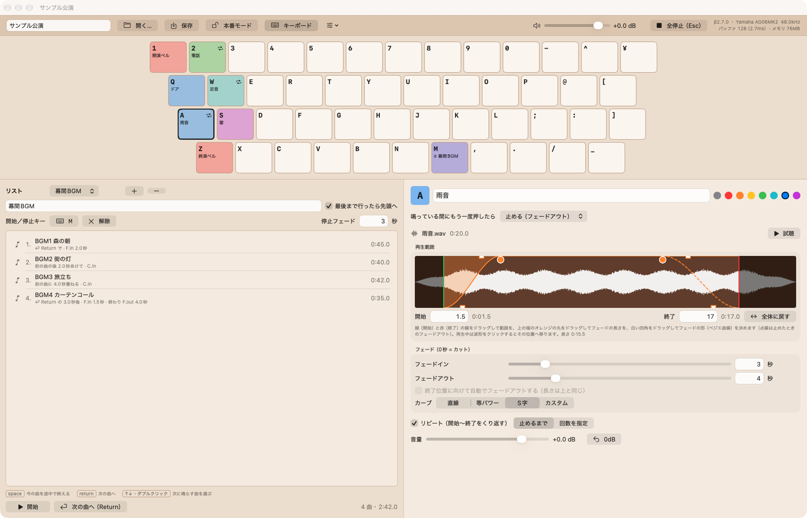
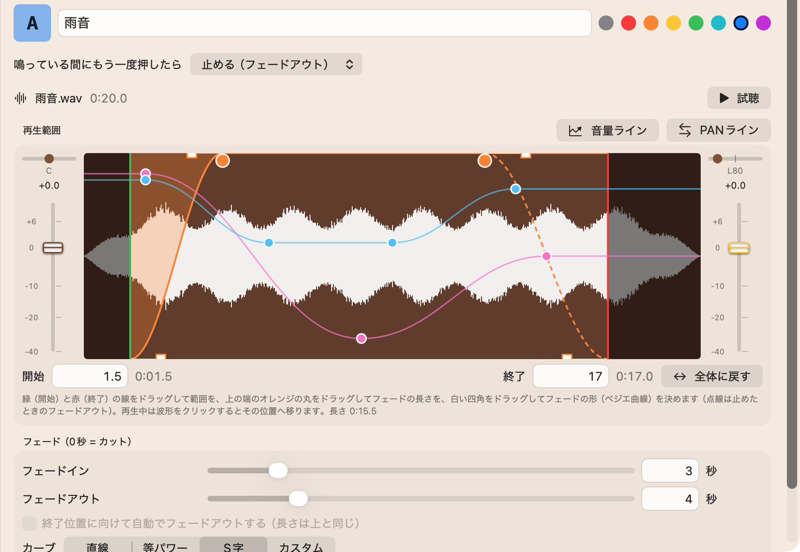
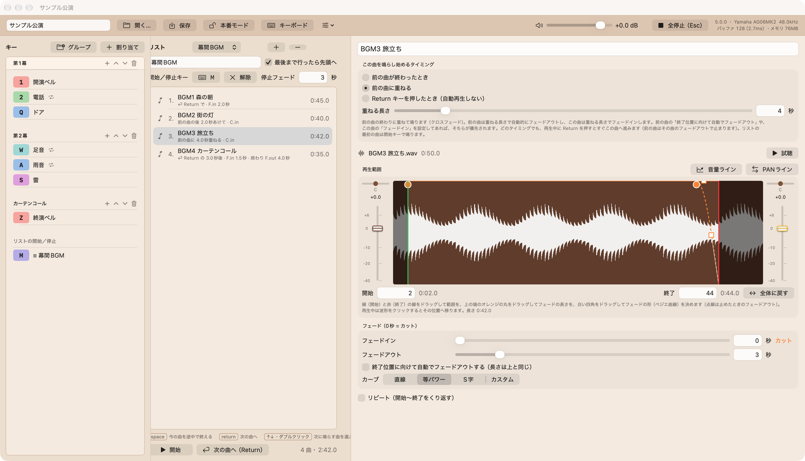
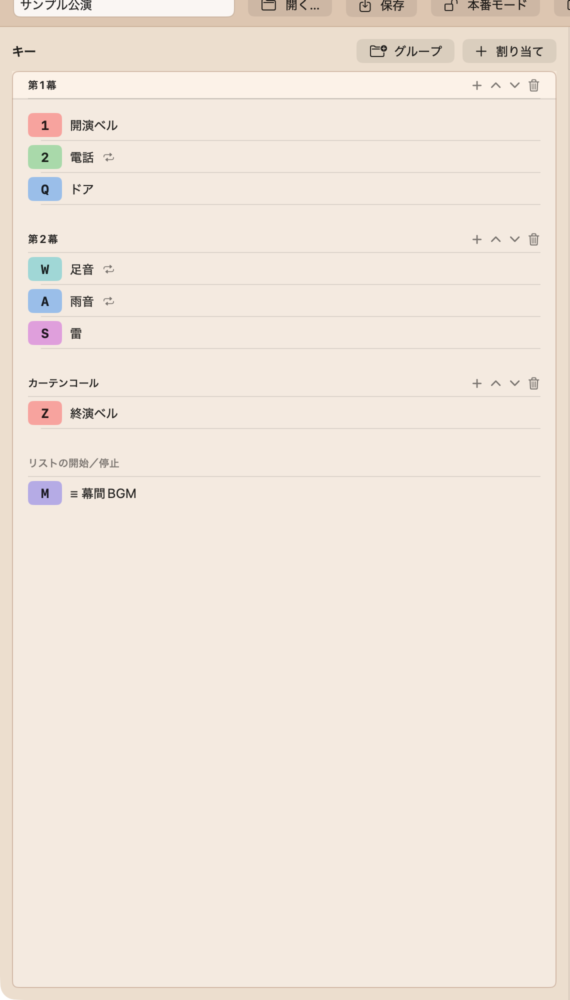
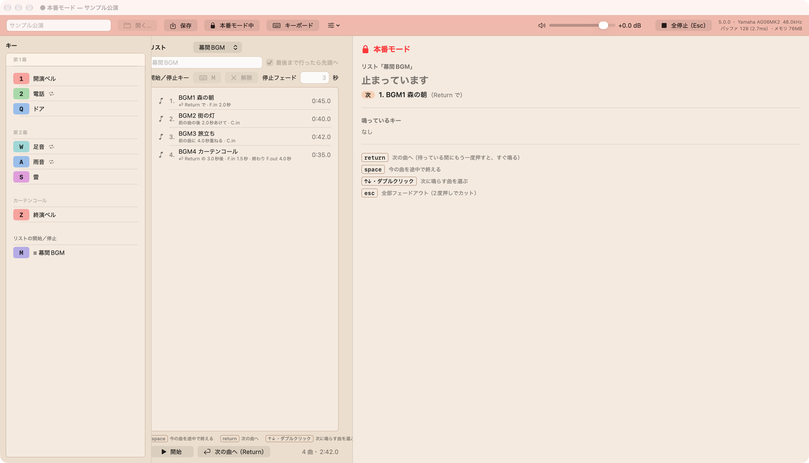
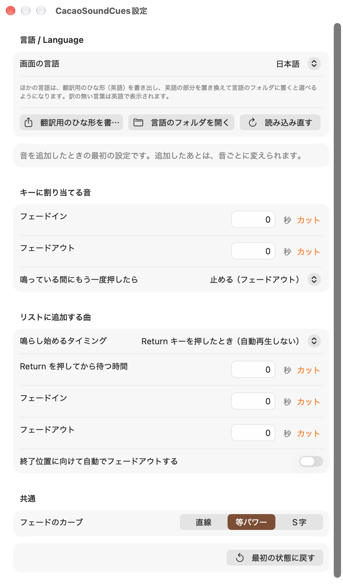

<!-- _class: lead -->
<!-- _paginate: false -->
<!-- _footer: "" -->

# CacaoSoundCues マニュアル

舞台のための、ポン出し音響アプリ
バージョン 5.0.2 ／ 2026 年 10 月

---

## このマニュアルで分かること

1. CacaoSoundCues でできること
2. インストールと画面の見かた
3. キーに効果音を割り当てて鳴らす
4. 幕間 BGM などを順番に流す「リスト」
5. 本番での操作（本番モード・キー操作）
6. 設定と、困ったときの対処

> 対応 Mac: **macOS 14 以降**。インターネット接続は不要です。MacBook だけで本番でポン出しができます。

CacaoSoundCues は**オープンソース**（MIT License）です。無料で使え、学校や劇団で自由に配れます。
https://github.com/ICTCacao/CacaoSoundCues

---

## CacaoSoundCues でできること

### キーで鳴らす（ポン出し）

- 音ファイルを**キーボードのキー**に割り当て、押せばすぐ鳴る
- 再生する範囲、フェードイン・フェードアウト、くり返しを音ごとに設定
- もう一度押すとフェードアウトして止まる

### リストで順番に流す

- 幕間 BGM などを**決めた順番**で流す
- 「前の曲が終わったら」「重ねて（クロスフェード）」「Return を押したら」から選べる
- キーの効果音と同時に鳴らせる

> 音を読み込んでおくので、キーを押してから鳴るまでの遅れがほとんどありません。

---

## 1. インストールと起動

1. **CacaoSoundCues-5.0.2.dmg** をダブルクリック
2. 左の **CacaoSoundCues** を右の **Applications** へドラッグ
3. dmg を閉じる（デスクトップの取り出しアイコンを取り出す）
4. アプリケーション フォルダの CacaoSoundCues をダブルクリック

扱える音ファイル：wav ／ aiff ／ mp3 ／ m4a など、Mac で再生できるもの。起動すると、前回開いていたキューシートが自動で開きます。

**「開発元を確認できない」などの警告が出たら**
macOS 15 以降：警告を閉じ、**システム設定 › プライバシーとセキュリティ** の **「このまま開く」** を押す。
macOS 14：アプリを **右クリック →「開く」→「開く」**。一度通せば次からは普通に起動できます。

---

## 2. 画面の見かた

上：ボタンと全体の音量 ／ 中：キーボード（割り当てたキーに色と名前） ／ 左下：リスト ／ 右下：選んだ音の設定

---

## 3. キューシート（保存するファイル）

- 公演 1 本ぶんの設定を **キューシート（.ccsc）** として保存します
- **使う音ファイルもキューシートの中にコピー**されます
- キューシートを USB などで運べば、**別の Mac でもそのまま**使えます

| 操作 | メニュー |
|---|---|
| 新しく作る | ファイル › 新規キューシート <kbd>⌘</kbd><kbd>N</kbd> |
| 開く | ファイル › 開く… <kbd>⌘</kbd><kbd>O</kbd> |
| 保存 | ファイル › 保存 <kbd>⌘</kbd><kbd>S</kbd> |

---

## 4. キーに音を割り当てる

1. Finder から音ファイルを、画面の**キーの上へドラッグ**
2. キーに色と名前が付けば完了
3. そのキーを押すと鳴ります。**もう一度押すと止まる**

**割り当てを変える**
- 割り当てたキーを**別のキーへドラッグ**すると移動
- 移した先にも割り当てがあれば**入れ替え**
- 外すときは、キーを右クリック →「割り当てを外す」

**使えるキー**
数字・英字・記号のキー。設定で **F1〜F12** と**テンキー**も使えます（上の帯の <kbd>☰</kbd> ボタン）。キーボードの大きさ（大・中・小）も、同じボタンで変えられます。

**使えないキー（操作用）**

| キー | 役目 |
|---|---|
| <kbd>return</kbd> | リストの次の曲へ |
| <kbd>space</kbd> | リストの今の曲を終える |
| <kbd>esc</kbd> | 全部止める |

---

## 5. 音の設定（キーをクリックすると右に出ます）

| 項目 | 内容 |
|---|---|
| 名前と色 | キーに表示される |
| もう一度押したら | 止める ／ 頭から ／ 重ねる ／ 何もしない |
| 再生範囲 | 鳴らす部分（開始・終了） |
| フェードイン・アウト | 秒で指定。**0 秒 = カット** |
| カーブ | 直線 ／ 等パワー ／ S字 ／ カスタム |
| リピート | 止めるまで、または回数を指定 |
| 音量・PAN | 波形の左のつまみ。再生中もすぐ効く |
| 音量ライン | 曲の中で音量を変える。右のつまみで記録も |
| PANライン | 曲の中で左右を変える。右上のスライダーで記録も |

「試聴」で鳴らして確かめられます。

---

## 6. 波形で再生範囲とフェードを決める

| つかむもの | 変わるもの |
|---|---|
| **緑の線** | 再生を始める位置 |
| **赤の線** | 再生を終える位置 |
| 上の端の**オレンジの丸** | フェードの長さ |
| **白い四角** | フェードの形（ベジエ曲線） |

- 白い四角を動かすと、カーブは「カスタム」になります
- **点線**は「止めたときのフェードアウト」の長さ
- 再生中に波形をクリックすると、その位置へ移ります

**再生中の表示**
フェードしている間は、黄色い線と点が、フェードの形の上を動きます。

- フェードイン：点が上がる ↑
- フェードアウト：点が下がる ↓

> フェードの数字は、下の欄に直接入れることもできます。入れたら <kbd>return</kbd> で確定します。

**音量ライン**
「音量ライン」を押すと、水色の線で曲の中の音量を描けます。クリックで点、ドラッグで移動、<kbd>⌥</kbd>クリックで削除。

---

## 7. リストを作る（幕間 BGM など）

「リスト」の ＋ で作り、曲のファイルをリストへドラッグ。開始／停止キー（例 <kbd>M</kbd>）も決められます。

---

## 7. リストとキーの使い分け

### ふつうの使い方
- **効果音**（ベル・電話・ドアなど）は**キー**に割り当てる → きっかけでそのキーを押す
- **BGM** は**リスト**にも**キー**にも置ける
  - 何曲かを順に流す（客入れ・幕間・客出しなど）なら**リスト** → <kbd>return</kbd> で次の曲へ
  - 場面に合わせて 1 曲を出し入れするなら**キー** → もう一度押すとフェードアウト

### リストだけでもポン出しができる
効果音も BGM も、次の音までに鳴り終わる（音が重ならない）なら、**全部を本番の順に 1 つのリストへ並べる**こともできます。
各曲の「鳴らし始めるタイミング」を「**Return キーを押したとき**」にしておけば、本番は <kbd>return</kbd> を押していくだけで、最後まで音出しができます。

- 次に鳴る音には「**Standby**」が付くので、きっかけを確かめながら進められる
- BGM の上に効果音を重ねる場面があるときは、効果音をキーに分けます

---

## 8. 曲の「鳴らし始めるタイミング」

曲をクリックすると、右側で選べます。

| タイミング | 動き |
|---|---|
| **Return キーを押したとき** | 自動では鳴らない。<kbd>return</kbd> で鳴る。「n 秒待って鳴らす」もできる |
| **前の曲が終わったとき** | 前の曲が終わったら自動で鳴る。間をあける秒数も決められる |
| **前の曲に重ねる** | 前の曲の終わりに重ねて鳴る（**クロスフェード**）。前の曲は自動で小さくなる |

- 「最後まで行ったら先頭へ」にチェックすると、くり返し流れます
- 鳴らすリストは**いつも 1 つ**。別のリストを始めると、前のリストは止まります

---

## 9. リストの操作キー

| キー | 動き |
|---|---|
| <kbd>return</kbd> | **次の曲へ**。今の曲はその曲のフェードアウトで止まる。リストが止まっていれば始める |
| <kbd>return</kbd> を 2 回 | 「n 秒待って鳴らす」の待ち時間を飛ばして、すぐ鳴らす |
| <kbd>space</kbd> | **今の曲を途中で終える**。次の曲はタイミングの設定どおりに続く |
| <kbd>↑</kbd> <kbd>↓</kbd> ／ ダブルクリック | **次に鳴らす曲を選ぶ**（鳴らさない）。選んだ曲に **Standby** と出る |
| 開始／停止キー | そのリストを始める ／ 止める |
| <kbd>esc</kbd> | **全部の音をすぐ止める**（フェードなし） |

> 例：幕が下りたら <kbd>space</kbd> で BGM を終える → 暗転の間をとって <kbd>return</kbd> で次の曲。

---

## 10. キーボードを隠して一覧にする

上の帯の **「キーボード」** を押すと、キーボードを隠し、**割り当てたキーだけ**を一覧で表示します。

- **グループ**（例：第1幕・第2幕）に分けられる
- 行をドラッグして並べ替え
- 右クリック →「グループへ移動」
- 音ファイルを一覧にドラッグ → 割り当てたいキーを押す

リスト中心の公演では、こちらの画面が見やすくなります。右側の設定も、上の帯の **「音源設定」** で隠せます。

---

## 11. 本番モード

「本番モード」（<kbd>⇧</kbd><kbd>⌘</kbd><kbd>L</kbd>）で、帯が赤くなり、右側に今の曲・残り時間・次の曲が大きく出ます。

---

## 11. 本番モードでできること・できないこと

### できる

- キーで鳴らす・止める
- <kbd>return</kbd> <kbd>space</kbd> <kbd>↑</kbd><kbd>↓</kbd> <kbd>esc</kbd>
- ダブルクリックで次の曲を選ぶ
- 全体の音量
- 保存

### できない（うっかり防止）

- 音の設定・割り当ての変更
- リストやグループの編集
- 試聴（客席に聞こえてしまうため）
- 波形のクリックでの移動
- 新規・開く

> 本番モードを終えるときと、アプリを終了するときは確認が出ます。起動し直しても本番モードのままです。

---

## 12. 設定（CacaoSoundCues › 設定… <kbd>⌘</kbd><kbd>,</kbd>）

**言語 / Language**
日本語と English を切り替え。メニューバーは起動し直すと切り替わります。
ほかの言語は「翻訳用のひな形を書き出す…」で英語のファイルを書き出し、訳して「言語のフォルダ」へ入れると選べます。

**音を追加したときの最初の設定**
キーの音・リストの曲を追加したときの、フェードやタイミングの初めの値です。

---

## 13. 本番前のチェックリスト

- ☐ キューシートを**保存**した（タイトルに「未保存」と出ていない）
- ☐ 本番で使う **Mac とスピーカー** で、すべての音を鳴らして確かめた
- ☐ 全体の音量と、Mac 本体の音量を決めた
- ☐ **リストの最初の曲をダブルクリックして、Standby にした**
- ☐ 通知を切った（集中モードなど）。スリープはアプリが止めます
- ☐ **本番モード**にした
- ☐ <kbd>esc</kbd>（全部止める）の場所を確かめた

> キューシートは USB などに**控え**も取っておくと安心です。

---

## 14. 困ったとき

| こんなとき | こうする |
|---|---|
| キーを押しても鳴らない | 文字の入力欄にカーソルが残っています。**リストやキーをクリック**するか <kbd>return</kbd> で確定 |
| F キーで鳴らない | <kbd>fn</kbd> を押しながら。または macOS の設定で「標準のファンクションキーとして使用」を ON |
| キーに ⚠ が出ている | 音ファイルが見つからないか、読めない形式。割り当て直す |
| 音が小さい・出ない | 全体の音量、音ごとの音量、Mac の出力先（右上に表示）を確かめる |
| 本番モードで編集できない | 上の帯の「本番モード中」を押して終了 |
| 間違えて鳴らした | そのキーをもう一度押す。全部なら <kbd>esc</kbd> |

---

## キー操作の早見表

| キー | 動き |
|---|---|
| 割り当てたキー | 鳴らす ／ もう一度で止める |
| <kbd>return</kbd> | リストの次の曲へ（2 回で待ち時間を飛ばす） |
| <kbd>space</kbd> | リストの今の曲を終える |
| <kbd>↑</kbd> <kbd>↓</kbd> | リストの次に鳴らす曲を選ぶ |
| <kbd>esc</kbd> | 全部の音をすぐ止める |
| <kbd>⇧</kbd><kbd>⌘</kbd><kbd>L</kbd> | 本番モードの入／切 |
| <kbd>⌘</kbd><kbd>S</kbd> ／ <kbd>⌘</kbd><kbd>O</kbd> ／ <kbd>⌘</kbd><kbd>N</kbd> | 保存 ／ 開く ／ 新規 |
| <kbd>⌘</kbd><kbd>,</kbd> | 設定 |

<!-- _footer: "CacaoSoundCues マニュアル ／ ICTCacao ／ 地方の劇団と、中高生の演劇の現場のために" -->
